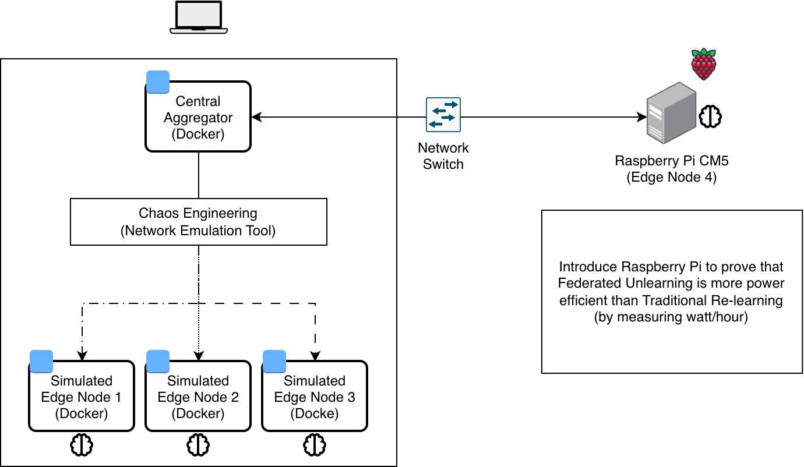
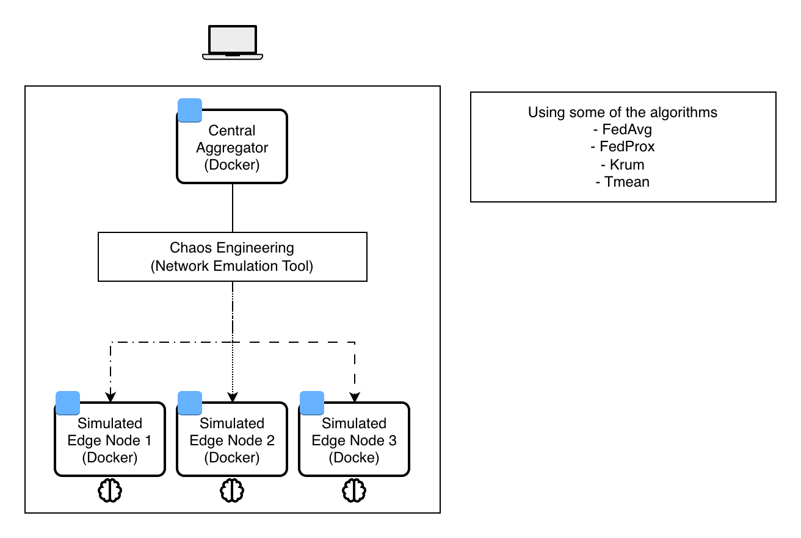

# Hardware-Aware Federated Unlearning: Implementing and Evaluating SISA on Edge Devices

MSc thesis code on Federated Learning for intrusion detection across IoT edge nodes, built with [Flower](https://flower.ai) 1.29.0 and PyTorch on the [TON_IoT](https://research.unsw.edu.au/projects/toniot-datasets) dataset.

The MSc part asks what it physically costs an edge device to *unlearn* poisoned data. A Raspberry Pi 5 (fanless, A1 SD card) joins a federation of three simulated nodes, gets poisoned, and then recovers either by naive retraining from scratch or with SISA (sharded, sliced training with checkpoint rollback). Time, energy, thermals and SD-card I/O are measured on the Pi during recovery.

The earlier course-assignment work (simulation only, everything in Docker) is kept under [`results/course/`](results/course/).



## Results at a glance

10 paired seeds (42–51), medians, recovery window on the Pi:

| | Naive | SISA | Ratio |
|---|---|---|---|
| Time to recover | 238.1 s | 28.3 s | 8.4× |
| Net recovery energy | 0.103 Wh | 0.018 Wh | 5.8× |
| Time thermally throttled | 227 s | 26 s | 8.7× |
| Written to SD card | 2.95 MB | 12.5 MB | 0.24× |

Every one of these is fully separated between the arms (Cliff's δ = ±1.00, Wilcoxon p = 0.002, the floor for N=10). Peak RAM use stays under 30% of the Pi's 4 GB in both arms (about 1030 vs 960 MB).

Seeds 50 and 51 were first run with the wrong poison fraction (0.5 instead of 1.0) and later rerun; the analysis uses the reruns, and the originals are kept in `results/msc/superseded/`.

The catch is model quality: at the default 0.5 threshold the SISA-recovered global model collapses to predicting "attack" for everything (balanced accuracy 0.50 vs 0.60 for naive). With a threshold picked on the federation's validation data it reaches 0.71 vs 0.68, so the problem is calibration rather than lost information. Control federations trained without any poison collapse the same way, so the cause is averaging the SISA constituents, not unlearning: an ensemble of the same constituents doesn't collapse. Both arms' recovered models stay within 0.02 of their clean controls in F1 and balanced accuracy.

A one-seed robustness pair under simulated WAN latency (40 ms ± 20 ms) gave 250.8 s vs 31.6 s, the same ~8× gap.

Full write-up: the thesis (Chapters 6–8).

## Repository layout

| Path | What's there |
|---|---|
| `edge_nodes/` | Client side: Flower ClientApp, model, data loading, poisoning, SISA training and both recovery scripts |
| `server/` | Flower ServerApp: aggregation strategy and round config |
| `experiments/` | MSc data prep, FNB58 power logger and meter check, cooldown gate, power-log trimming; `run/` (campaign steps), `controls/`, `model_size/`, `locality/` |
| `analysis/` | Paired statistics, utility re-scoring, unlearning checks, model-size and locality analysis |
| `tests/` | Smoke test for the unlearning guarantee (synthetic data) |
| `ansible/` | Raspberry Pi provisioning |
| `results/course/` | Course-phase results (FedAvg, FedProx, Krum, TrimmedMean) |
| `results/msc/campaign/` | One folder per run of the main campaign |
| `results/msc/controls/` | Control runs on the Pi: clean federations and poisoned SISA with kept constituents |
| `results/msc/model_size/` | Model-size benchmark session; `validation/` has full runs at widths 384 and 1280 |
| `results/msc/locality/` | Poisoning-locality sweep: one Phase 1 and 30 recoveries |
| `results/msc/tables/` | All derived CSVs (`campaign_*`, `controls_*`, `model_size_*`, `locality_*`) |
| `results/msc/superseded/` | Runs replaced by reruns, kept for reference (see below) |
| `docs/diagrams/` | Architecture diagrams |

Run folders are named `naive_seedN` / `sisa_seedN` for the main campaign. The two `wan_*_seed42` folders are the WAN robustness pair; the `wan_` prefix keeps them out of `campaign_paired_stats.csv`. Each run folder holds `phases.log`, `power_fnb58.csv`, `hardware_telemetry_*.csv`, `recovery_manifest.json`, `recovered_model.pt`, `results_phase{1,4}.json` and the per-round global checkpoints (`sisa_timings.jsonl` too, for SISA). Large files are stored with Git LFS, so run `git lfs pull` after cloning.

The folders in `results/msc/superseded/` are named after the study, the run and the reason it was replaced. None of them is used in the analysis.

| Folder | Why it was replaced |
|---|---|
| `campaign_{naive,sisa}_seed{50,51}_wrong_fraction` | Poison fraction 0.5 instead of 1.0; rerun with 1.0 |
| `campaign_sisa_seed50_other_session` | Ran on a different day than its naive pair (Pi idle at 51 °C vs 68 °C); the pair was rerun in one session |
| `model_size_session_meter_drops` | First benchmark session; the power meter dropped out several times, so the whole session was repeated |
| `model_size_w1280_sisa_seed42_no_power` | Validation run whose recovery phase has no power data; rerun |
| `locality_permission_error` | First start of the sweep, stopped at the first recovery by a file permission error; no recovery result |

## Setup

You need a macOS host with [Git LFS](https://git-lfs.com), Python 3.11+ and [Docker Desktop](https://www.docker.com/products/docker-desktop/). The run scripts use macOS tools (`ipconfig`, Homebrew).

**1. Clone the repo.** The run results (checkpoints, power logs, telemetry) are stored with Git LFS, so pull those too:

```sh
git clone https://github.com/StamenchoBog/master-thesis.git
cd master-thesis
git lfs install
git lfs pull
```

**2. Add the dataset.** Download the TON_IoT **Network dataset** (23 `Network_dataset_*.csv` files, about 3.3 GB) from the [UNSW page](https://research.unsw.edu.au/projects/toniot-datasets) and put the files directly in `data/`. They're not in git. Check:

```sh
ls data/Network_dataset_*.csv | wc -l    # should print 23
```

**3. Install the Python packages** in a virtual environment. `analysis` adds the statistics dependencies, `power` adds the USB power-meter driver:

```sh
python3 -m venv .venv
source .venv/bin/activate
pip install -e ".[analysis,power]"
brew install libusb    # needed by the power logger
```

**4. Give Docker enough memory.** Preprocessing loads the whole dataset, so set Docker Desktop to at least 12 GB (Settings > Resources > Memory). Check:

```sh
docker info --format '{{.MemTotal}}' | awk '{printf "%.1f GB\n", $1/1024/1024/1024}'    # ~11.7 GB for a 12 GB setting
```

You only need the Raspberry Pi for the MSc experiment; the course simulation and the analysis run on this machine alone.

## Course-phase simulation (all local)

Everything runs in Docker on one machine:



```sh
docker compose run --rm preprocessor    # build per-node caches, once
docker compose up
```

Settings are environment variables on `superexec-serverapp` in `docker-compose.yml`:

| Variable | Default | Description |
|---|---|---|
| `FL_STRATEGY` | `fedavg` | `fedavg`, `fedprox` (proximal term for non-IID drift), `krum` (Byzantine-tolerant), `trimmedmean` (drops outliers) |
| `NUM_ROUNDS` | `10` | Federation rounds |
| `MIN_FIT_CLIENTS` / `MIN_EVAL_CLIENTS` / `MIN_AVAILABLE_CLIENTS` | `3` | Clients required per stage |
| `RESULTS_SUFFIX` | empty | Appended to the results filename so variants don't overwrite each other |

## Reproducing the MSc experiment

One run is one arm (`naive` or `sisa`) for one seed. Someone has to be there for the power meter and the cooldown wait, so it isn't fully automated, but each step is a script in `experiments/run/`.

### One-time

```sh
NUM_PARTITIONS=4 docker compose run --rm preprocessor     # 4-way caches (3 sim nodes + Pi)
ssh admin@rasp5node.local "cd master-thesis && HOST_IP=<host LAN IP> docker compose -f docker-compose.edge.yml build"
```

Provision the Pi with Ansible first (see below) and keep its checkout of this repo up to date. An old `docker-compose.edge.yml` on the Pi quietly ignores `FLEET_PORT`.

### Per run

Run the steps in order from the repo root. Each one takes the arm (`naive` or `sisa`), the seed, and optionally `--wan`:

```sh
experiments/run/01_prepare.sh naive 42
experiments/run/02_instruments.sh naive 42
experiments/run/03_train.sh naive 42
experiments/run/04_recover.sh naive 42
experiments/run/05_rejoin.sh naive 42
experiments/run/06_collect.sh naive 42
```

| Script | What it does |
|---|---|
| `01_prepare.sh` | Builds the seed's data, copies the Pi's partition over, checks the seed matches, clears old Pi state |
| `02_instruments.sh` | Checks power (`throttled=0x0`), drops caches, waits for the cooldown plateau, starts telemetry and the power logger |
| `03_train.sh` | Phase 1: 10 federated rounds with poisoned labels |
| `04_recover.sh` | Phase 3: `naive_retrain` or `sisa_recover` on the Pi (the measured window) |
| `05_rejoin.sh` | Phase 4: 5 rejoin rounds from the Phase-1 global model |
| `06_collect.sh` | Stops everything and moves the results into the run folder |

Results land in `results/msc/campaign/<arm>_seed<N>/` (`wan_<arm>_seed<N>/` with `--wan`). `HOST_IP` is detected from `en0`; set it yourself if that's wrong. If `02_instruments.sh` reports sticky throttle bits, reboot the Pi and run it again. If a run stops halfway, stop the power logger and the containers by hand (the first lines of `06_collect.sh`), then delete the run folder before starting over.

With `--wan`, the Pi's traffic goes through a 40 ms ± 20 ms toxiproxy link. Nodes 1–3 always go through a separate 5 ms ± 3 ms proxy, standing in for three separate devices.

## Analysis

Run from the repo root:

```sh
python -m analysis.analyze_runs                  # campaign_summary.csv + campaign_paired_stats.csv (time, energy, thermals, I/O, RAM)
python -m analysis.build_val_sets                # val_seed{S}.npz, the nodes' validation splits per seed
python -m analysis.evaluate_utility --phase1 \
  --test-template 'data/.cache/msc/test_seed{seed}.npz' \
  --val-template 'data/.cache/msc/val_seed{seed}.npz'   # campaign_utility.csv (balanced metrics)
python -m analysis.evaluate_controls             # controls_scores.csv + controls_stats.csv
python -m analysis.evaluate_model_size           # model_size_measurements.csv + model_size_predictions.csv
python -m analysis.evaluate_locality             # locality_runs.csv + locality_summary.csv
python -m analysis.evaluate_model results/msc/campaign/naive_seed42/recovered_model.pt
python -m analysis.evaluate_unlearning results/msc/campaign/sisa_seed42/recovered_model.pt
```

`evaluate_utility` scores each seed's models on that seed's own test set (`test_seed{S}.npz`, disjoint from its training data; the loop that builds them is in the script's docstring). Besides the 0.5 threshold it picks a threshold on the nodes' validation splits and applies it to the test set (`*_val` columns), and for comparison the test-optimal one (`*_tuned`). The two give practically the same balanced accuracy. Plain recall/F1 are misleading here, since the test set is 96.5% attacks and a model that flags everything still scores recall 1.0.

`evaluate_controls` uses the control runs (`experiments/controls/run.sh SEED`, same topology as the campaign with the Pi as node 4, no power meter). Per seed: a clean federation for each arm (15 rounds = Phase 1 + Phase 4), and a poisoned SISA run whose five constituents are kept before and after recovery. It compares each arm's Phase-4 model with its clean control (H5 in the registered form, 0.02 tolerance), the clean arms with each other, and the constituents' parameter average with their ensemble.

`evaluate_model_size` fits the cost model T = U / throughput + N · checkpoint time + load time to the benchmark (`experiments/model_size/run.sh`, four model widths, three repetitions) and checks it against full campaign runs at widths 384 and 1280 (`experiments/model_size/validate.sh`). `evaluate_locality` uses the locality sweep (`experiments/locality/run.sh`): one SISA Phase 1, then recoveries with the poison in different slices and in one to five shards, plus naive retraining as the reference.

`experiments/trim_power_logs.py` cuts each `power_fnb58.csv` down to the phase-marker window. Output doesn't change; the files just get small enough for git.

## Tests

```sh
docker run --rm -v "$PWD":/app -w /app --entrypoint python fl-ids-preprocessor:latest tests/smoke_test.py
```

Uses synthetic data (no dataset needed). Checks that poison placement is deterministic and confined, that label flipping only happens in memory, that SISA writes one checkpoint per round/shard/slice, and that recovery rolls back to a clean checkpoint and is bit-identical across reruns.

Linting (config in `.flake8`, `.yamllint` and `.shellcheckrc`):

```sh
pip install -e ".[dev]"
flake8 .
yamllint .
shellcheck experiments/*.sh experiments/run/*.sh
```

The same checks run on GitHub on every push.

## Raspberry Pi provisioning

1. Flash Raspberry Pi OS Lite with your SSH public key.
2. Check it's reachable: `ssh -i ~/.ssh/<key> admin@rasp5node.local`
3. Provision:

   ```sh
   cd ansible
   ansible-playbook -i inventory.ini setup_node.yaml --ask-become-pass
   ```

If the key has a passphrase, `ssh-add` it first, since Ansible can't prompt for it.

The playbook stops APT timers, turns swap off permanently (Debian 13 `rpi-swap` → `Mechanism=none`), locks the CPU governor to `performance`, installs Docker with local log rotation, and deploys `~/msc-experiment/monitor.sh`, which writes telemetry to `/dev/shm` so it never adds to the SD-card I/O being measured. Leave the fan unplugged; the thermal behaviour is part of what's being measured.

## License

MIT, see [LICENSE](LICENSE).
